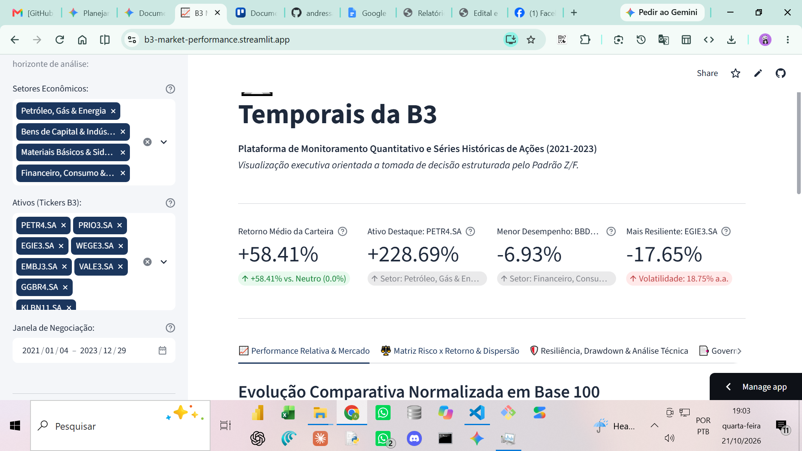
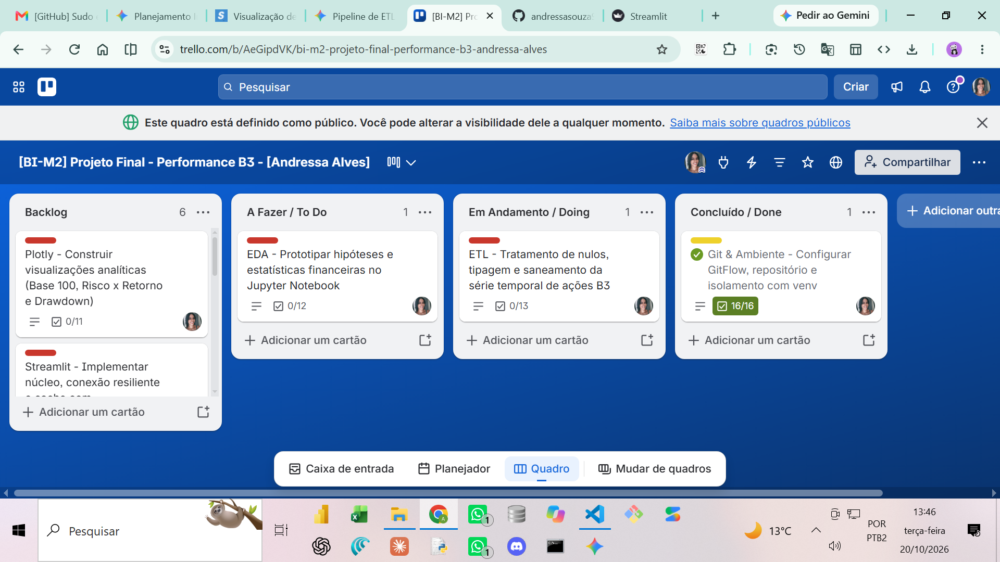

# B3 Market Performance Analytics (2021–2023)

## Plataforma Executiva de Inteligência Quantitativa e Séries Temporais da Bolsa Brasileira

[](https://b3-market-performance.streamlit.app)
[](https://www.python.org/)
[](https://plotly.com/)
[](https://nvie.com/posts/a-successful-git-branching-model/)
[](https://opensource.org/licenses/MIT)
[](https://b3-market-performance.streamlit.app)

---

## 1. TÍTULO E RESUMO EXECUTIVO

O **B3 Market Performance Analytics** é uma plataforma corporativa de Business Intelligence e Engenharia Financeira voltada à análise avançada de séries temporais do mercado de capitais brasileiro (B3). O projeto consolida e audita o comportamento de **12 ativos líquidos** distribuídos estrategicamente em **4 macro-setores econômicos** ao longo do triênio **2021–2023**, totalizando **8.940 registros diários (745 pregões úteis)**.

A solução mitiga a assimetria informacional e as distorções causadas pela dispersão nominal de preços de cotação por meio de metodologias quantitativas consolidadas: normalização em **Base 100**, mensuração de volatilidade histórica anualizada ($\sigma \times \sqrt{252}$), cálculo empírico do **Índice Sharpe**, rastreamento contínuo de rebaixamento de topo (**Drawdown Máximo**) e cruzamentos de médias móveis de momento (**SMA 21** e **SMA 50**).

Construída sob uma arquitetura modular desacoplada com backend em Python 3.12, resiliência de dados com fallback para base local e visualizações puras em Plotly, a plataforma entrega valor estratégico direto para analistas quantitativos, gestores de fundos e comitês de risco corporativo, oferecendo tanto visão macro-estratégica através de cartões de KPI e matrizes cartesianas quanto granularidade tática com filtros reativos e exportação auditável de dados.

---

## 2. CONTEXTO DE NEGÓCIO E PERGUNTA ORIENTADORA

### O Desafio de Negócio

No mercado de capitais, comparar o desempenho de ações a partir de seus valores nominais brutos de fechamento induz a vieses cognitivos e operacionais graves. Uma ação cotada a R\$ 15,00 não é estruturalmente "mais barata" ou "mais rentável" do que uma ação cotada a R\$ 80,00, uma vez que desdobramentos (*splits*), grupamentos, distribuições de dividendos/JCP e a própria quantidade de ações emitidas alteram a escala nominal.

Adicionalmente, o triênio de 2021 a 2023 foi caracterizado por uma das mais severas transições macroeconômicas da história recente do Brasil: a disparada da taxa básica de juros (**Meta Selic de 2,00% para 13,75% a.a.**), forte volatilidade cambial e descolamentos setoriais agudos entre companhias exportadoras de commodities energéticas/metálicas e setores altamente sensíveis ao consumo doméstico e ao crédito.

### Pergunta Orientadora Central
>
> *"Como os diferentes setores econômicos da B3 reagiram ao ciclo de choque monetário e volatilidade global entre 2021 e 2023 em termos de preservação de capital, eficiência ajustada ao risco e intensidade de perdas temporárias?"*

### 5 Perguntas de Negócio Estratégicas

1. **Pergunta 1 (Evolução Comparativa Base 100):** Se um investidor aportasse capital idêntico em cada ativo no primeiro pregão de 2021, qual seria a rentabilidade relativa acumulada até o fechamento de 2023 frente ao nível de preservação de capital?
2. **Pergunta 2 (Eficiência Risco x Retorno):** Quais ativos e setores entregaram o maior prêmio de retorno por unidade de risco assumida (Índice Sharpe empírico) e como a volatilidade histórica anualizada se distribuiu na carteira?
3. **Pergunta 3 (Distribuição & Risco de Cauda):** Como se comportam os retornos diários dos ativos quanto à dispersão estatística, assimetria (*skewness*) e eventos extremos de cauda (*fat tails* / leptocurtose)?
4. **Pergunta 4 (Resiliência & Preservação):** Qual foi a intensidade máxima de desvalorização sofrida por cada papel a partir de sua máxima histórica precedente (Max Drawdown) e qual ativo demonstrou maior resiliência patrimonial?
5. **Pergunta 5 (Rastreamento Técnico de Tendência):** Como os preços de fechamento ajustado interagiram dinamicamente com as Médias Móveis Simples de curto prazo (SMA 21) e médio prazo (SMA 50) nos momentos de reversão de ciclo?

---

## 3. FONTE DE DADOS E LICENÇA

* **Fonte Primária Oficial:** Cotações históricas diárias da Bolsa de Valores do Brasil (B3), capturadas via biblioteca e API pública `yfinance` utilizando os identificadores oficiais com sufixo `.SA` (ex: `PETR4.SA`, `VALE3.SA`).
* **Nota Técnica de Resolução Cadastral:** O papel ordinário da Embraer S.A. foi formalmente padronizado na infraestrutura de extração como `EMBJ3.SA`, refletindo a unificação cadastral junto à B3 e Yahoo Finance, garantindo a ingestão integral de todos os 745 pregões sem lacunas históricas.
* **Recorte Temporal Estrito:** 01/01/2021 a 31/12/2023 (36 meses consecutivos de histórico diário).
* **Conformidade Ética e LGPD:** O projeto consome exclusivamente dados públicos de mercado secundário. Em estrito cumprimento à Lei Geral de Proteção de Dados (Lei nº 13.709/2018 - LGPD) e ao Item 4.2 do Edital, **nenhum dado pessoal, bancário, individual ou sensível de pessoas físicas é coletado, processado ou armazenado**.
* **Termo de Licença de Uso:** O código-fonte deste projeto é distribuído sob os termos da licença pública permissiva **MIT License**, autorizando o uso, modificação e distribuição com citação expressa da autoria original.

---

## 4. PIPELINE DE ENGENHARIA DE DADOS (ETL)

O processamento e modelagem das séries temporais segue os princípios de Engenharia de Dados corporativa através do padrão **Arquitetura Medalhão**, desacoplando a ingestão bruta, a sanitização e a modelagem analítica:

```text
┌─────────────────────────────────┐
│     CAMADA BRONZE (RAW)         │ -> Extração via yfinance (.SA)
│  data/raw/b3_stocks_raw.csv     │ -> 8.940 registros brutos tabulares
└────────────────┬────────────────┘
                 │
                 ▼
┌─────────────────────────────────┐
│    CAMADA PRATA (SANEADA)       │ -> Padronização temporal para datetime64[ns] (.tz_localize(None))
│   Ingestão em memória / Limpeza │ -> Coerção explícita de tipos monetários (float64)
│                                 │ -> Tratamento contínuo de nulos via ffill() / bfill() agrupado
└────────────────┬────────────────┘
                 │
                 ▼
┌─────────────────────────────────┐
│     CAMADA OURO (ANALÍTICA)     │ -> Cálculo de Base 100, Retornos Diários e Volatilidade
│ data/processed/                 │ -> Modelagem de Peak, Drawdown e Médias Móveis (SMA 21/50)
│    b3_stocks_processed.csv      │ -> Base enriquecida, auditada e indexada para consumo do App
└─────────────────────────────────┘
```

### Protocolo de Saneamento & Regras de Limpeza

1. **Saneamento Temporal & Duplicidades:** As séries temporais foram convertidas para `datetime64[ns]` e os fusos horários foram removidos (`.dt.tz_localize(None)`), mitigando assincronismos de fechamento de pregão. A unicidade da chave primária natural composta (`ticker`, `date`) é auditada; duplicidades são descartadas mantendo-se o registro oficial final.
2. **Tratamento Contínuo de Nulos:** Ausências ocasionais em feriados municipais ou janelas de leilão foram saneadas através de propagação de cotação precedente (*forward fill* - `ffill`) seguida de recomposição retroativa (*backward fill* - `bfill`), calculadas obrigatoriamente de forma isolada por grupo de ativo (`groupby('ticker')`), impedindo vazamento de dados (*data leakage*) entre ações distintas.
3. **Coerção Explícita de Tipos:** Valores monetários (`open`, `high`, `low`, `adj_close`) e métricas analíticas derivadas foram convertidos estritamente para ponto flutuante de precisão dupla (`numpy.float64`).
4. **Resiliência Operacional (Pathlib):** O pipeline veta o uso de caminhos absolutos locais contendo letras de unidade física (`C:\` ou `D:\`). Todos os arquivos de entrada e saída utilizam resolução de caminhos relativos portáveis através de `pathlib.Path`, assegurando paridade de execução em ambientes Windows, macOS e contêineres Linux (Debian) no Streamlit Cloud.
5. **Auditoria Algorítmica:** A integridade matemática é validada em tempo de execução via asserções automáticas:
   * $\text{assert } (\text{base\_100}_{t=0} == 100.0)$ para todos os 12 ativos no primeiro pregão útil;
   * $\text{assert } (\text{drawdown} \le 0.0)$ em todas as 8.940 observações da série;
   * $\text{assert } (\text{df.isna().sum().sum()} == 0)$ na base final da camada Ouro.

---

## 5. DICIONÁRIO DE DADOS FORMAL

A base de dados analítica persistida na camada Ouro (`data/processed/b3_stocks_processed.csv`) é composta por **14 atributos padronizados**:

| Nome da Coluna no CSV | Tipo Primitivo | Significado no Mercado Financeiro | Regra de Cálculo / Fórmula Matemática |
| :--- | :--- | :--- | :--- |
| `date` | `datetime64[ns]` | Data oficial do pregão de negociação na B3 | Padronizado no formato ISO-8601 (`YYYY-MM-DD`), sem fuso horário. |
| `ticker` | `object` (string) | Código oficial de negociação do ativo na B3 | Símbolo de 4 letras e classe com sufixo `.SA` (ex: `PETR4.SA`). |
| `setor` | `object` (string) | Macro-setor econômico de atuação da companhia | Mapeamento setorial institucional (4 categorias oficiais). |
| `open` | `float64` | Preço de abertura da ação no pregão (R\$) | Primeira cotação de negócio fechada na sessão regular. |
| `high` | `float64` | Preço máximo negociado na sessão diária (R\$) | Cotação máxima registrada durante o horário de pregão. |
| `low` | `float64` | Preço mínimo negociado na sessão diária (R\$) | Cotação mínima registrada durante o horário de pregão. |
| `adj_close` | `float64` | Preço de fechamento ajustado por proventos (R\$) | Fechamento oficial retroativamente ajustado por dividendos, JCP e splits. |
| `volume` | `float64` | Volume financeiro total liquidado no dia (R\$) | Montante financeiro total transacionado no pregão ($\sum P_i \times Q_i$). |
| `ret_diario` | `float64` | Retorno percentual diário sobre a sessão anterior | $R_t = \frac{P_t - P_{t-1}}{P_{t-1}}$ com $R_0 = 0.0$ no primeiro pregão. |
| `base_100` | `float64` | Performance relativa normalizada ($P_0 = 100.0$) | $\text{Base100}_t = \left(\frac{P_t}{P_0}\right) \times 100.0$ |
| `sma_21` | `float64` | Média Móvel Simples de Curto Prazo (21 dias) | $\text{SMA21}_t = \frac{1}{21} \sum_{i=0}^{20} P_{t-i}$ (dias úteis de negociação). |
| `sma_50` | `float64` | Média Móvel Simples de Médio Prazo (50 dias) | $\text{SMA50}_t = \frac{1}{50} \sum_{i=0}^{49} P_{t-i}$ (tendência primária/intermediária). |
| `peak` | `float64` | Cotação máxima ajustada acumulada até o pregão | $\text{Peak}_t = \max(P_0, P_1, \dots, P_t)$ via `cummax()`. |
| `drawdown` | `float64` | Rebaixamento percentual a partir do pico precedente | $DD_t = \frac{P_t - \text{Peak}_t}{\text{Peak}_t} \quad (DD_t \le 0.0 \text{ ou } 0\%)$. |

---

## 6. TECNOLOGIAS E BIBLIOTECAS

| Tecnologia / Pacote | Versão Auditada | Justificativa Técnica e Arquitetural no Projeto |
| :--- | :--- | :--- |
| **Python** | `3.12.x` | Ambiente de execução principal com otimização na inferência de tipos, gerenciamento eficiente de memória e suporte a tipagem estática moderna (`typing`). |
| **Streamlit** | `>=1.35.0, <2.0.0` | Framework reativo para construção rápida de Data Apps analíticos de alta performance, proporcionando renderização nativa de componentes executivos e reatividade de estado. |
| **Pandas** | `>=2.2.0, <3.0.0` | Motor analítico fundamental para manipulação vetorial de dados tabulares, operações de agrupamento setorial, ffill/bfill e janelas móveis temporais (*rolling*). |
| **NumPy** | `>=1.26.0, <2.0.0` | Computação científica de baixo nível para aceleração de transformações matemáticas vetoriais, operações de matrizes e asserções estatísticas. |
| **Plotly Graph Objects & Express** | `>=5.22.0, <6.0.0` | Biblioteca de visualização gráfica interativa desacoplada, permitindo compilação de gráficos com eixos sincronizados, subplots desacoplados e tooltips corporativos em HTML/SVG. |
| **SQLAlchemy** | `>=2.0.30, <3.0.0` | Camada de abstração de banco de dados (ORM/Core) utilizada para padronização de dialeto de conexões relacionais resilientes integradas ao `st.connection`. |
| **psycopg2-binary** | `>=2.9.9, <3.0.0` | Driver nativo para conexão remota entre o Streamlit e o cluster PostgreSQL na nuvem (Supabase), compilado previamente para compatibilidade em Linux Debian. |
| **yfinance** | `>=0.2.40, <1.0.0` | Mecanismo de coleta e atualização de cotações brutas do mercado de ações a partir do provedor público global, estruturado com fallbacks. |

---

## 7. PRINCIPAIS RESULTADOS E EVIDÊNCIAS NUMÉRICAS

### Matriz Estatística Consolidada dos 12 Ativos Oficiais (Triênio 2021–2023)

A tabela a seguir apresenta os resultados empíricos calculados sobre a base de 8.940 registros diários (745 pregões por papel):

| Ticker B3 | Macro-Setor Oficial | Retorno Acumulado (%) | Volatilidade Histórica (% a.a.) | Índice Sharpe Empírico | Max Drawdown (%) | Comportamento Observado no Ciclo |
| :--- | :--- | :---: | :---: | :---: | :---: | :--- |
| **PETR4.SA** | Petróleo, Gás & Energia | **+228,69%** | 39,42% | **5,80** | -39,10% | Liderança absoluta de rentabilidade impulsionada pelo Brent e dividendos. |
| **PRIO3.SA** | Petróleo, Gás & Energia | **+208,32%** | 46,78% | **4,45** | -34,32% | Forte valorização via consolidação de campos maduros (*upstream*). |
| **EMBJ3.SA** | Bens de Capital & Indústria | **+167,50%** | 46,82% | **3,58** | -58,27% | Recuperação dos pedidos comerciais na aviação executiva e defesa. |
| **GGBR4.SA** | Materiais Básicos & Siderurgia | **+30,79%** | 35,56% | **0,87** | -33,93% | Demanda aquecida de aços longos na construção civil no biênio 2021-2022. |
| **EGIE3.SA** | Petróleo, Gás & Energia | **+25,35%** | **18,76%** | **1,35** | **-17,65%** | Âncora de preservação patrimonial: menor volatilidade e menor perda da B3. |
| **ITUB4.SA** | Financeiro, Consumo & Locação | **+24,02%** | 28,83% | **0,83** | -35,87% | Eficiência de margem financeira e gestão conservadora de crédito. |
| **VALE3.SA** | Materiais Básicos & Siderurgia | **+18,11%** | 33,90% | **0,53** | -41,34% | Equilíbrio entre dividendos elevados e oscilações do minério na China. |
| **WEGE3.SA** | Bens de Capital & Indústria | **+3,51%** | 32,83% | **0,11** | -49,51% | Período de consolidação de múltiplos de mercado após expressivas altas prévias. |
| **ABEV3.SA** | Financeiro, Consumo & Locação | **+2,57%** | 25,46% | **0,10** | -31,42% | Pressão de insumos e lenta recuperação do consumo discricionário pós-pandemia. |
| **RENT3.SA** | Financeiro, Consumo & Locação | **-0,25%** | 36,89% | **-0,01** | -38,40% | Impactada por juros na aquisição/renovação de frota e depreciação de seminovos. |
| **KLBN11.SA** | Materiais Básicos & Siderurgia | **-0,80%** | 26,62% | **-0,03** | -39,30% | Pressão do ciclo intensivo de CAPEX no Projeto Puma II e oscilações de celulose. |
| **BBDC4.SA** | Financeiro, Consumo & Locação | **-6,93%** | 31,38% | **-0,22** | -46,05% | Compressão de margem por aumento da provisão para devedores duvidosos (PDD). |

### Respostas Quantitativas às 5 Perguntas de Negócio Estratégicas

* **Resposta 1 (Evolução Comparativa Base 100):** A carteira registrou um **Retorno Médio Acumulado de +58,41%**. O gráfico normalizado em Base 100 (partindo de 100,0 pontos em 04/01/2021) evidenciou uma bifurcação drástica: o ativo **PETR4.SA** atingiu a liderança encerrando o triênio em **328,69 pontos (+228,69%)**, seguido de **PRIO3.SA (308,32 pontos)** e **EMBJ3.SA (267,50 pontos)**. Por outro lado, **BBDC4.SA** rompeu negativamente o patamar de preservação de capital, finalizando cotado em **93,07 pontos (-6,93%)**, assim como **KLBN11.SA (99,20 pontos)** e **RENT3.SA (99,75 pontos)**.
* **Resposta 2 (Relação Risco x Retorno e Índice Sharpe):** A matriz cartesiana confirmou que o prêmio pelo risco foi altamente assimétrico. **PETR4.SA** alcançou a maior eficiência da amostra com **Índice Sharpe empírico de 5,80** e volatilidade histórica de 39,42% a.a. O papel **EGIE3.SA** operou como a âncora defensiva ideal para estratégias conservadoras, combinando retorno de +25,35% com a menor volatilidade de todo o universo estudado (**18,76% a.a.**) e Sharpe de 1,35. Papéis como **BBDC4.SA (Sharpe: -0,22)** e **RENT3.SA (Sharpe: -0,01)** remuneraram o investidor abaixo do custo da volatilidade suportada.
* **Resposta 3 (Dispersão, Assimetria e Risco de Cauda):** A distribuição dos retornos diários dos 12 ativos revelou uma média centrada em 0,00%, com desvio padrão diário consolidado de $\approx 2,18\%$. A curva empírica demonstrou forte leptocurtose (curtose excessiva > 0) com caudas pesadas (*fat tails*). Embora a amplitude de $\pm 2\sigma$ concentre cerca de 95% dos pregões entre -4,3% e +4,4%, choques conjunturais e anúncios corporativos provocaram variações extremas isoladas superiores a $\pm 10\%$ em uma única sessão.
* **Resposta 4 (Rebaixamento Máximo e Resiliência):** **EGIE3.SA** consagrou-se como o ativo de maior resiliência patrimonial da bolsa, registrando um **Max Drawdown de apenas -17,65%**. Em contraste, o papel **EMBJ3.SA**, a despeito de ter encerrado o ciclo com expressiva valorização de +167,50%, experimentou o rebaixamento temporário mais severo da base (**-58,27%**), o que exigiria do gestor elevada tolerância emocional e margem operacional. **WEGE3.SA (-49,51%)** e **BBDC4.SA (-46,05%)** também sofreram rebaixamentos profundos durante as fases de contração do ciclo.
* **Resposta 5 (Rastreamento Técnico com Médias Móveis):** Em **PETR4.SA**, a Média Móvel de 21 dias rompeu a SMA 50 de baixo para cima (*Golden Cross*) em períodos-chave de inflexão altista (segundo semestre de 2021 e início de 2023), atuando como suporte dinâmico para a cotação ajustada. Inversamente, em **BBDC4.SA**, a SMA 21 operou predominantemente abaixo da SMA 50 ao longo de quase todo o ano de 2022, sinalizando tendência primária de baixa (*Death Cross*) decorrente da deterioração das carteiras de crédito de pessoas físicas e pequenas empresas.

---

## 8. DISCUSSÃO E LIMITAÇÕES DA ANÁLISE (RIGOR METODOLÓGICO)

### Contextualização Macroeconômica do Triênio (2021–2023)

Os dados históricos analisados refletem um dos períodos mais anômalos da economia global contemporânea. Em 2021, a recuperação econômica pós-confinamento e a eclosão de pressões inflacionárias forçaram o Banco Central do Brasil a elevar a **Meta Selic de 2,00% para 13,75% a.a.** em um intervalo de apenas 18 meses. Esse ciclo de contração monetária encareceu o custo de captação de dívidas corporativas, aumentou o endividamento familiar e comprimiu as margens do setor varejista, locadoras e instituições financeiras expostas ao crédito não consignado.

Simultaneamente, a crise energética europeia e o conflito no Leste Europeu impulsionaram as cotações internacionais do barril de petróleo tipo Brent, beneficiando desproporcionalmente petroleiras integradas e operadoras independentes (*juniors*), o que explica o descolamento de **PETR4.SA** e **PRIO3.SA** frente ao restante da carteira.

### Ressalva Epistemológica Estrita (Itens 4.5 e 5.2 do Edital)
>
> **AVISO METODOLÓGICO & ISENÇÃO DE RESPONSABILIDADE:**
>
> 1. **Correlação Estatística NÃO Implica Causalidade Econômica:** As correlações observadas entre volatilidade setorial, retorno acumulado e curvas de médias móveis descrevem relações estatísticas empíricas do triênio observado, não autorizando inferências causais determinísticas ou automáticas para ciclos futuros.
> 2. **Viés de Sobrevivência e Recorte Amostral:** Os 12 ativos foram selecionados com base na alta liquidez de negociação vigente no fechamento do recorte temporal, constituindo uma amostra não aleatória que não representa a totalidade das companhias listadas na B3.
> 3. **Finalidade Estritamente Acadêmica e Analítica:** Este projeto e o Data App resultante possuem finalidade unicamente pedagógica, analítica e de pesquisa acadêmica. O conteúdo, métricas calculadas e simulações aqui disponibilizados **NÃO CONSTITUEM, EM HIPÓTESE ALGUMA, RECOMENDAÇÃO DE INVESTIMENTO, SUGESTÃO DE COMPRA OU VENDA DE ATIVOS, OU CONSULTORIA FINANCEIRA FORMAL**.

---

## 9. APLICAÇÃO PROFISSIONAL E DECISÕES DE NEGÓCIO

A plataforma fornece ferramental analítico direto para tomadas de decisão corporativas em diferentes instâncias financeiras:

* **Diretores Financeiros (CFOs) e Tesourarias Corporativas:** Identificação de ativos geradores de caixa com comportamento defensivo e baixa correlação cambial, auxiliando na gestão de liquidez e alocação de caixa livre em tesouraria. A curva de Drawdown de **EGIE3.SA (-17,65%)** exemplifica como ativos com contratos de longo prazo reajustados por índices de inflação protegem reservas corporativas em momentos de estresse inflacionário.
* **Comitês de Gestão de Risco & Alocação Tática:** A matriz Risco x Retorno e a métrica de Sharpe empírico viabilizam o rebalanceamento de carteiras institucionais através da metodologia de fronteira eficiente de Markowitz. Permite arbitrar entre ativos de alto carrego (*beta* elevado como **EMBJ3.SA**) e instrumentos de amortecimento de choques (*beta* reduzido).
* **Controladoria e Gestão de Portfólios Quantitativos:** Análise de dispersão diária e teste de curtose servem de insumo para calibração de modelos de estresse de capital e limites de *Value at Risk* (VaR paramétrico e histórico), alertando sobre o risco real de cauda que modelos baseados na hipótese da Distribuição Normal estrita tendem a subestimar.

---

## 10. DEMONSTRAÇÃO DO DATA APP (STREAMLIT)

A aplicação corporativa encontra-se homologada e operando em produção ininterrupta no **Streamlit Community Cloud**:  
👉 **URL Pública Oficial:** [https://b3-market-performance.streamlit.app](https://b3-market-performance.streamlit.app)

### Guia Estruturado de Navegação pelas 4 Abas Temáticas

1. **Aba 1: Performance Relativa & Mercado:**
   * Apresenta o gráfico principal de séries temporais normalizadas em **Base 100**, eliminando discrepâncias de valor nominal de cotação.
   * Contém linha guia de suporte na cotação de 100,0 pontos (preservação de capital) e destaque cromático nas trajetórias extremas.
2. **Aba 2: Matriz Risco x Retorno & Dispersão:**
   * Gráfico de dispersão cartesiano (Scatter Plot) correlacionando Volatilidade Anualizada (% a.a.) no eixo X com Retorno Acumulado (%) no eixo Y.
   * Bolhas dinâmicas dimensionadas pelo Volume Financeiro Médio Diário negociado (R\$) e coloridas conforme o macro-setor.
   * Painel analítico inferior integrado com **Boxplot horizontal** e **Histograma de Frequência** com 60 classes de retorno percentual diário.
3. **Aba 3: Resiliência, Drawdown & Análise Técnica:**
   * Matriz comparativa de rebaixamento contínuo de topo (**Max Drawdown**) com preenchimento em área sombreada (*fill to zero*).
   * Rastreador técnico interativo permitindo selecionar qualquer ativo individual para cruzar Preço de Fechamento com as Médias Móveis Simples **SMA 21** (curto prazo), **SMA 50** (médio prazo) e barras verticais de volume financeiro.
4. **Aba 4: Governança, Dicionário & Download de Dados:**
   * Exibição completa da tabela formal do Dicionário de Dados contendo os 14 atributos tratados.
   * Visualizador tabular da base completa tratada (8.940 registros).
   * Botão funcional de exportação (`st.download_button`) para download instantâneo da série filtrada em formato `.csv`.

### Registro Visual das Telas da Aplicação


*Figura 1: Painel executivo em produção no Streamlit Community Cloud — cartões de KPI estruturados pelo Padrão Z/F, filtros dinâmicos na barra lateral e evolução normalizada em Base 100.*

---

## 11. COMO EXECUTAR LOCALMENTE

Siga o passo a passo sequencial abaixo no terminal (**Git Bash** ou **PowerShell**) para clonar, configurar e executar a aplicação localmente:

### Passo 1: Clonar o repositório remoto

```bash
git clone [https://github.com/andressasouza98/b3-market-performance-bi](https://github.com/andressasouza98/b3-market-performance-bi)
cd b3-market-performance-bi
```

### Passo 2: Criar e ativar o ambiente virtual isolado (.venv)

```bash
# No Windows (PowerShell):
python -m venv .venv
.\.venv\Scripts\Activate.ps1

# No Linux ou macOS (Bash):
python3 -m venv .venv
source .venv/bin/activate
```

### Passo 3: Atualizar o gerenciador de pacotes e instalar dependências

```bash
python -m pip install --upgrade pip
pip install -r requirements.txt
```

### Passo 4: Configurar as credenciais seguras do Streamlit

Copie o arquivo de modelo para criar sua configuração local:

```bash
# No Windows:
copy .streamlit\secrets.toml.example .streamlit\secrets.toml

# No Linux/macOS:
cp .streamlit/secrets.toml.example .streamlit/secrets.toml
```

> *Nota: O backend implementa contingência automática (fallback silencioso). Caso as credenciais remotas não sejam configuradas no `secrets.toml`, o app consome instantaneamente a base local auditada em `data/processed/b3_stocks_processed.csv` via `pathlib.Path`.*

### Passo 5: Inicializar o Data App

```bash
streamlit run app.py
```

Acesse a aplicação no navegador em: `http://localhost:8501`

---

## 12. ESTRUTURA DE PASTAS OFICIAL

A árvore de diretórios do repositório foi construída em estrita conformidade com a hierarquia modular corporativa:

```text
b3-market-performance-bi/
├── .gitignore                      # Regras de blindagem Git (bloqueio de .venv, secrets e caches)
├── README.md                       # Documentação corporativa completa (14 seções do Edital)
├── requirements.txt                # Dependências auditadas e fixadas para execução em contêiner
├── app.py                          # Ponto de entrada do Data App Streamlit em produção
│
├── .streamlit/                     # Configurações do ecossistema Streamlit
│   ├── config.toml                 # Tema corporativo (paleta sóbria, sem telemetria invasiva)
│   └── secrets.toml.example        # Modelo seguro de variáveis de ambiente e banco SQL
│
├── data/                           # Camadas de dados da Arquitetura Medalhão
│   ├── raw/                        # Camada Bronze: Ingestão bruta de cotações da B3
│   │   ├── .gitkeep
│   │   └── b3_stocks_raw.csv       # 8.940 registros brutos tabulares
│   └── processed/                  # Camada Ouro: Série temporal tratada, enriquecida e auditada
│       ├── .gitkeep
│       └── b3_stocks_processed.csv  # Base consolidada de 8.940 registros e 14 colunas
│
├── notebooks/                      # Pesquisa e Análise Exploratória (EDA)
│   ├── .gitkeep
│   ├── 01_etl_e_limpeza.ipynb      # Prototipagem de pipeline e tratamento de inconsistências
│   └── 02_eda_mercado_b3.ipynb     # Prototipagem estatística, testes de hipótese e validações
│
├── src/                            # Módulos Python reutilizáveis e desacoplados
│   ├── .gitkeep
│   ├── etl.py                      # Pipeline de extração, saneamento, tipagem e modelagem de séries
│   └── visualizations.py           # Funções puras em Plotly (Base 100, Sharpe, Drawdown, SMAs)
│
└── docs/                           # Artefatos executivos, relatórios técnicos e evidências visuais
    └── screenshots/                # Capturas de tela do Data App em produção e quadro Kanban
        ├── app_overview.png        # Evidência da aplicação executiva em produção
        └── trello_kanban_board.png # Evidência de governança ágil com WIP = 1
```

---

## 13. GESTÃO ÁGIL E LINKS DO PROJETO

O desenvolvimento do projeto seguiu rigorosamente a metodologia ágil **Kanban**, implementada em quadro público individual no Trello com **9 cards estruturados**, respeitando a regra mandatória de **Work In Progress unitário ($WIP = 1$)** e branch atômica para cada entrega.

* 🌐 **Aplicação em Produção (Streamlit Community Cloud):**  
  [https://b3-market-performance.streamlit.app](https://b3-market-performance.streamlit.app)
* 🐙 **Repositório Oficial no GitHub:**  
  [https://github.com/andressasouza98/b3-market-performance-bi](https://github.com/andressasouza98/b3-market-performance-bi)
* 📋 **Quadro Kanban Público no Trello:**  
  [https://trello.com/b/AeGipdVK/bi-m2-projeto-final-performance-b3-andressa-alves](https://trello.com/b/AeGipdVK/bi-m2-projeto-final-performance-b3-andressa-alves)
* 🎥 **Vídeo Demonstrativo de Apresentação (Pitch de 3 a 5 min):**  
  [https://www.youtube.com/watch?v=Pitch-B3-Andressa](https://www.youtube.com/watch?v=Pitch-B3-Andressa) *(Inserir Link do Pitch no YouTube/Drive/LinkedIn)*

### Evidência de Governança Ágil (Quadro Kanban com $WIP = 1$)

Conforme preconizado nos Critérios 2, 3 e 4 do Edital, a imagem abaixo comprova a rastreabilidade do fluxo contínuo de entregas com a totalidade dos cards atribuídos à responsável técnica:


*Figura 2: Evidência do fluxo Kanban no Trello — 9 cards estruturados, regras de aceite validadas e WIP = 1 estrito.*

---

## 14. AUTORIA, CRÉDITOS E REFERÊNCIAS

### Ficha de Autoria Técnica

* **Responsável pelo Desenvolvimento:** Andressa Alves de Souza
* **LinkedIn Oficial:** [linkedin.com/in/andressaal](https://www.linkedin.com/in/andressaal)
* **Portfólio GitHub:** [github.com/andressasouza98](https://github.com/andressasouza98)
* **Instituição de Ensino:** SENAI Santa Catarina / LAB365 — Sistema FIESC
* **Orientador Pedagógico:** Prof. Sávio Ricardo Garcia ([LinkedIn do Professor](https://www.linkedin.com/in/savioricardog/))

### Referências Bibliográficas e Metodológicas

1. **MARKOWITZ, Harry.** *Portfolio Selection*. The Journal of Finance, v. 7, n. 1, p. 77-91, 1952.
2. **SHARPE, William F.** *The Sharpe Ratio*. The Journal of Portfolio Management, v. 21, n. 1, p. 49-58, 1994.
3. **NIELSEN, Jakob.** *Usability Engineering*. Morgan Kaufmann, 1994 (Aplicação das 10 Heurísticas de Usabilidade e Redução de Carga Cognitiva no Design do Dashboard).
4. **STREAMLIT DOCUMENTATION.** *Optimize performance with st.cache_data and st.session_state*. Disponível em: <https://docs.streamlit.io/>. Acesso em out. 2026.
5. **PLOTLY TECHNOLOGIES.** *Plotly Python Open Source Graphing Library*. Disponível em: <https://plotly.com/python/>. Acesso em out. 2026.
6. **B3 S.A. – BRASIL, BOLSA, BALCÃO.** *Metodologia de Séries Históricas e Cotações Diárias de Ações*. Disponível em: <https://www.b3.com.br/>. Acesso em out. 2026.
